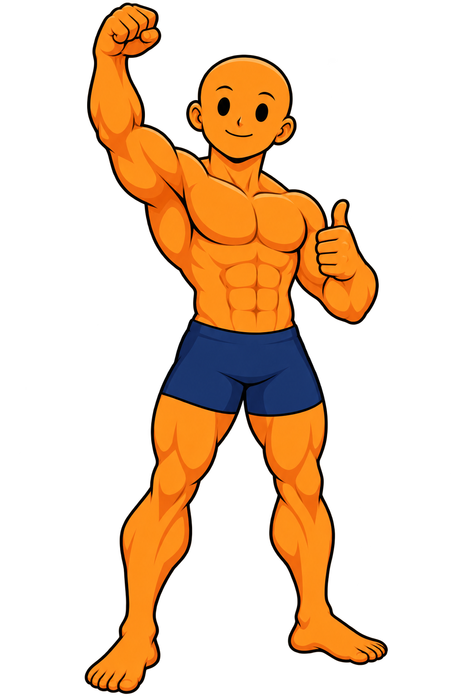

<p align="center">
  
</p>

<h1 align="center">StreakIn</h1>
<p align="center"><strong>Build strength. Learn skills. Own your progress.</strong></p>
<p align="center">Your all-in-one calisthenics app for turning ambition into action.<br />Skill roadmaps. Guided workouts. Custom routines. Progress you can see.</p>
<p align="center"><a href="https://streakin.my.id"><strong>Try StreakIn live →</strong></a> · <a href="#what-you-can-do">Explore the features</a> · <a href="#run-it-locally">Run it locally</a></p>
<p align="center"><a href="https://github.com/alifiandz/streakin/actions/workflows/verify.yml"></a></p>

<p align="center">
  
  
  
  
  
  
  
  
  
  
</p>

<p align="center"></p>
<p align="center"><em>Your next chapter starts with a hello. Let's get moving.</em></p>

## Stop wondering where to start. Start moving.

**StreakIn brings your calisthenics journey into one place: what to train, how to work toward it, and what to do next.** Go from choosing a goal to following a session, logging your work, and coming back with a clearer next step.

Build toward your first **L-Sit, Handstand, or Elbow Lever** with illustrated, five-stage roadmaps. Choose a **5, 10, 15, or 30-minute** session, train with hold and rest timers, create your own routines, and track completed workouts, skill records, and milestones. Recommendations account for your available time, equipment, and selected ability.

From a quick session between classes to a focused skill practice, StreakIn puts structure behind the ambition. **Three Free foundation paths. Nine ready-to-follow programs. Unlimited sessions and history. One place to keep showing up.**

**[Find your next move at streakin.my.id →](https://streakin.my.id)**

<p align="center"></p>
<p align="center"><em>Pick your goal. I'll help you find the next step.</em></p>

## What you can do

| Your goal | How StreakIn helps |
| --- | --- |
| Learn a skill without guessing the next step | Five-stage roadmaps for L-Sit, Handstand, and Elbow Lever. |
| Fit movement into a busy day | Time-aware sessions and nine ready-to-follow Free programs. |
| Stay focused while training | Exercise illustrations, hold and rest timers, pause, and session recovery. |
| See the work adding up | Workout history, skill records, and progress views based on completed activity. |
| Make training your own | Equipment and ability preferences, recommendations, and a custom routine builder. |
| Explore before committing | A clearly labelled demo account with sample training history. |

The Free experience includes all three foundation roadmaps, unlimited sessions and history, and one custom routine. The interface is in Indonesian, with familiar exercise names.

<p align="center"></p>
<p align="center"><em>One set at a time. One step closer.</em></p>

## Built around real life

- **A clear next action.** Recommendations consider your time, equipment, and selected ability.
- **Progress you confirm.** Completing a session does not automatically claim you have mastered a skill.
- **Room for interruptions.** Workout checkpoints help you return to an unfinished session.
- **A character with purpose.** Original Orange Dude illustrations carry the coaching and visual identity throughout the product.

## Current project status

StreakIn is a working product prototype, built by [Alif](https://github.com/alifiandz). The live frontend is hosted at **[streakin.my.id](https://streakin.my.id)**.

Training records currently stay in your browser. Use the Profile backup/export tools before switching devices or clearing browser data. Google account sign-in is configured on the production domain; it does not provide cloud synchronization of workout records.

Pro previews include Front Lever, Planche, and Muscle-Up paths. Payment processing, production subscription enforcement, cloud workout synchronization, and AI form analysis are not connected. Local plan switching is for preview/testing. The independently tested server entitlement implementation is retained in [`v3/server/`](v3/server/README.md).

## Run it locally

Use **Node.js 24**:

```bash
git clone https://github.com/alifiandz/streakin.git
cd streakin
npm ci --ignore-scripts
npm run dev
```

To verify and generate the static site:

```bash
npm run typecheck
npm run build
npm test
```

The build is generated in `dist/`. Production Google sign-in settings are domain-specific; see [`GOOGLE_SIGN_IN_SETUP.md`](GOOGLE_SIGN_IN_SETUP.md) for configuration.

## Under the hood

| Technology | Role in StreakIn |
| --- | --- |
| React + TypeScript | Typed components, application state, and interactive training screens. |
| Vite | Local development and production static builds. |
| Tailwind CSS + PostCSS + Autoprefixer | Utility styling, CSS processing, and browser compatibility. |
| React Router | Client-side navigation and deep links. |
| Supabase JavaScript SDK | Google account authentication on the production domain. |
| Lucide React | Interface icons. |
| clsx + tailwind-merge | Conditional classes and Tailwind class composition. |
| Browser localStorage | Device-local profiles, workout history, preferences, and session checkpoints. |
| Node.js + SQLite | Independently tested server entitlement implementation, not connected to the live frontend. |
| jsdom + React Test Renderer + Node assertions | UI journeys, component checks, and training/data regressions. |
| GitHub Actions | Automated type checks, builds, tests, and downloadable release artifacts. |
| Jagoan Hosting + Webuzo / VPS | Current production hosting with manual static-file releases. |

| Location | Purpose |
| --- | --- |
| `prototype/main.tsx` | Active application entry point. |
| `v3/` | Product screens, skill catalogue, training logic, and shared state. |
| `context/` | Account and workout state. |
| `public/images/` | Branding, exercise art, and Orange Dude illustrations. |
| `tests/` | Account, training, progression, persistence, and compiled UI journeys. |

GitHub Actions checks types, builds the app, runs the existing test suite, and uploads a static build artifact. Production releases currently use a manual Webuzo upload; pushing to GitHub does not automatically deploy the website.

## Explore the build

- [Feature inventory and roadmap](docs/PRODUCT_COMPLETENESS.md)
- [Product and interface decisions](docs/V3_DESIGN.md)
- [Feature matrix and integration boundaries](docs/V3_FEATURE_MATRIX.md)
- [GitHub migration and deployment notes](docs/GITHUB_MIGRATION.md)

Found a bug or have an idea? [Open an issue](https://github.com/alifiandz/streakin/issues) with what you tried and what happened.

---

**Your next move does not have to be big. It just has to begin.**

[Start your first session →](https://streakin.my.id)
